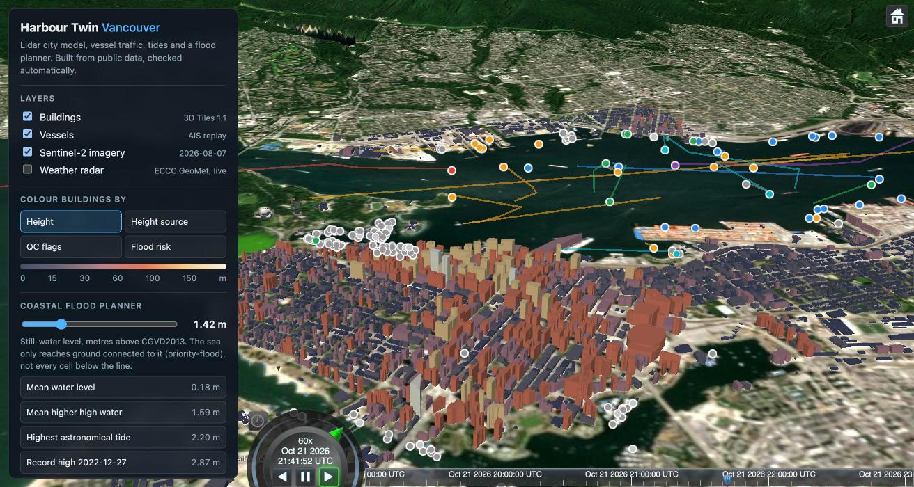
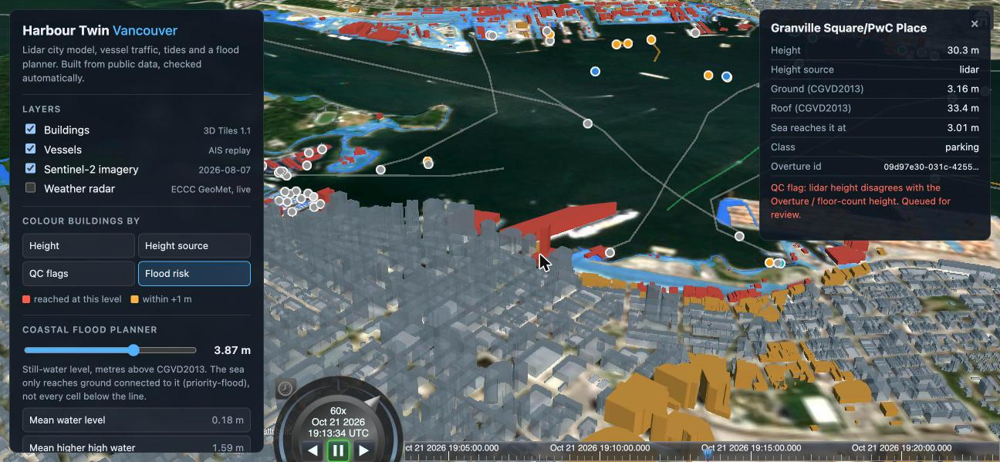
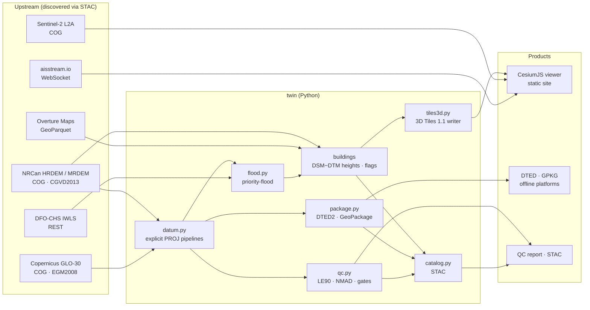
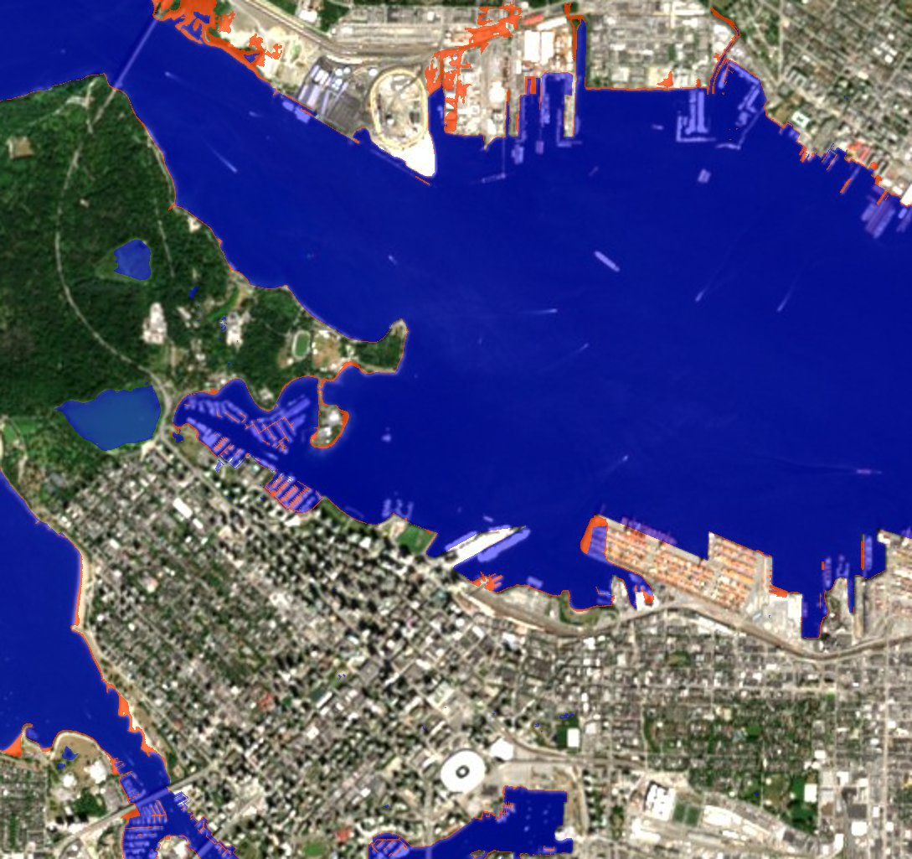

# Harbour Twin

**A 3D digital twin of Vancouver Harbour, built entirely from public data and checked automatically.**
It covers lidar-measured buildings as OGC 3D Tiles 1.1, datum-checked terrain, live-recorded AIS vessel traffic, observed tides, a connected coastal-flood planner, and DTED / GeoPackage packages for platforms that operate offline.

**Run the viewer:** `make serve`, then open http://127.0.0.1:8765 · [QC report](data/vancouver/QC_REPORT.md) · [STAC catalog](data/vancouver/stac/catalog.json) · Offline products: `data/vancouver/offline/`



*The bundled replay is a 4-hour live capture (21 Oct 2026, 19:03–23:03 UTC): 347 vessels, 7,854 cleaned positions, 769 track segments. The flood planner can follow the CHS-observed tide on the same clock.*

## What it does

| | |
|---|---|
| **Finds data through STAC** | NRCan HRDEM 1 m lidar + MRDEM-30 (NRCan STAC), Copernicus GLO-30 + Sentinel-2 L2A (Earth Search), Overture Maps buildings, water and piers (Overture STAC → GeoParquet). |
| **Reads only what it needs** | Windowed COG reads over HTTP range requests (choosing the right overview level), plus bbox-filtered GeoParquet in DuckDB. A full rebuild takes about 2 minutes and downloads no whole files. |
| **Gets vertical datums right** | Explicit PROJ pipelines for EGM2008, CGVD2013 (CGG2013a geoid + NAD83(CSRS) frame), WGS 84 ellipsoid (for Cesium / 3D Tiles) and EGM96 (DTED), each tested against EPSG reference values. |
| **QCs every elevation product** | Bias, RMSE, NMAD, LE90/LE95 by slope class against lidar, gated against product specs. Sea-surface sanity checks. A deliberate datum-error case proves the gates catch it. |
| **Measures building heights** | DSM − DTM from lidar for 98.7% of buildings. Heights that disagree with Overture/OSM are flagged for review, not silently overwritten. |
| **Publishes 3D Tiles 1.1** | glTF with `EXT_mesh_features` + `EXT_structural_metadata`, so every building is clickable and styleable by height, source, QC flag or flood level. 69/69 tiles pass the Khronos glTF validator with 0 errors and 0 warnings. |
| **Integrates live feeds** | AIS (aisstream.io WebSocket → GeoParquet → CZML), observed water levels and station datums (DFO-CHS IWLS), radar (ECCC GeoMet WMS), current weather (Open-Meteo). |
| **Plans for floods** | Priority-flood gives the still-water level at which the sea actually *reaches* each cell and each building, not a bathtub threshold. Presets come from CHS station levels converted to CGVD2013. |
| **Packages for denied environments** | DTED Level 2 (MIL-PRF-89020B grid and header, with vertical accuracy filled from the measured LE90) and a GeoPackage holding a float32 elevation coverage, buildings and AIS tracks. |
| **Describes its outputs** | A static STAC catalog with projection, checksums, lineage back to upstream STAC items, and the QC verdict. |

## What the QC found

All numbers are recomputed on every pipeline run ([full report](data/vancouver/QC_REPORT.md)). Errors are product minus lidar, in metres, on a 30 m grid over 400k land cells.

| Comparison | Bias | NMAD | LE90 | Takeaway |
|---|---:|---:|---:|---|
| NRCan MRDEM-30 DTM vs lidar DTM, slope < 5° | **0.02** | 0.72 | **0.69** | Same datum, near-zero bias: an independent confirmation of the datum chain. |
| Copernicus GLO-30 vs lidar DTM, open ground | −0.15 | 1.57 | 4.64 | Once EGM2008 → CGVD2013 is applied, the radar DEM is unbiased where nothing stands on the ground. |
| Copernicus GLO-30 vs lidar DSM, all land | −2.36 | 2.00 | 6.69 | Passes DTED Level 2 (18 m) but not the 4 m figure in a forested city. Fine for drone and vessel terrain, not for a city-scale twin. This is why the twin uses lidar. |
| GLO-30 heights handed to Cesium unconverted | **+16.52** | 2.16 | 19.15 | The classic 3D-globe datum bug. Both gates **fail**, which is the point. |

**Datum audit at the AOI centre:** the geoid undulation is −19.05 m. PROJ's *default* CGVD2013 → WGS 84 transform is off by **0.30 m** here, because it uses a ballpark frame and skips the NAD83(CSRS) → WGS 84 Helmert step (it's off by 1.05 m in St. John's). The explicit pipeline in [`twin/datum.py`](twin/datum.py) fixes this, and a test pins it.

**Building heights:** comparing Overture's published heights with lidar gives a median offset of −1.2 m for City of Vancouver data, −2.1 m for Microsoft ML footprints and −4.0 m for OpenStreetMap. Lidar recovers the towers: Hyatt 196.9 m (published 201), One Wall Centre 148.5 m (150), MNP Tower 142.8 m (144). It also catches the outliers, such as the 190.8 m Paradox tower tagged as 10 m in OSM. 717 buildings are flagged for review.

**Flood screen** (still-water levels, CGVD2013; buildings reached out of 5,848):

| Level | m | Buildings |
|---|---:|---:|
| Mean higher high water (CHS) | 1.59 | 97 |
| Highest recorded, 27 Dec 2022 (CHS) | 2.87 | 152 |
| Record + 1 m sea-level rise | 3.87 | 461 |
| Record + 2 m | 4.87 | 938 |

The lowest levels are mostly structures on piers and floats. This is a planning screen, not a hydrodynamic model.



## How it is built



**Design choices**

- **Integrate first, build second.** Every source is someone else's maintained product, reached through its STAC API or published GeoParquet. The code adds what is missing: datum alignment, QC, lidar heights, flood connectivity and packaging.
- **Every height carries its datum.** Rasters are tagged, 3D Tiles metadata names CGVD2013, DTED is EGM96 by spec, and Cesium gets WGS 84 ellipsoidal heights. Conversions never go through PROJ's automatic choice.
- **Flag, don't resolve.** When lidar and Overture disagree on a building's height, the building keeps the lidar value and carries a `height_flag`, visible in the viewer and in the GeoParquet.
- **Precompute in the pipeline, keep the client thin.** The flood level is a per-building attribute and a per-cell grid, so the browser only compares a number against the slider.
- **No vendor tokens.** Terrain is served from two small int16 grids through `CustomHeightmapTerrainProvider`, so the viewer runs anywhere without a Cesium ion key.
- **One command rebuilds and checks the twin.** `make data test validate` re-runs the whole pipeline from upstream, then gates on 44 unit and acceptance tests plus the glTF validator. The viewer is a static folder (`web/`) that any web server can host.

## Run it

```bash
make setup                  # Python venv + glTF validator
make data                   # rebuild everything for Vancouver (~2 min)
make test validate          # unit + acceptance tests, glTF validation
make serve                  # http://127.0.0.1:8765

echo "AISSTREAM_API_KEY=..." > .env   # free key from aisstream.io
make record MIN=120 && make ais       # capture fresh vessel traffic
make data AOI=stjohns                 # another city: config/stjohns.yaml
```

A new city is one YAML file: AOI bounding boxes, a CHS tide station, sea check points and the specs to gate against.

```
twin/            pipeline package (sources, datum, qc, flood, tiles3d, ais, tides, package, catalog, cli)
config/          one YAML per city
tests/           unit tests + acceptance tests on the published products
web/             CesiumJS viewer; web/data/<aoi>/ is what the pipeline publishes for it
data/<aoi>/      QC report, lineage, GeoParquet, STAC catalog (rasters/DTED/GPKG rebuilt by `make data`)
tools/           Khronos glTF validator runner
```

## Built with AI, checked by machines

I built this in one day with an AI coding agent (Claude Code) writing most of the code while I set direction, made the domain decisions and reviewed output. The lesson worth showing is not the speed. It's that **automated checks caught things that looked fine**:

- **Reads were 900x too big.** The first QC run timed out because rasterio's `WarpedVRT` ignores COG overviews. Fixed by picking the overview level explicitly: >10 min → 16 s.
- **The imagery had a seam.** The "least cloudy" Sentinel-2 scene sat on a swath edge and left half the AOI empty. Scenes are now ranked by measured AOI coverage first.
- **The water mask was wrong.** Overlaying the flood mask on Sentinel-2 (pictured below) showed lidar TIN interpolation "fans" across the harbour counted as land. The fix uses the OSM coastline and pier polygons from Overture.
- **PROJ's defaults are a ballpark.** The datum audit exposed the 0.3–1.05 m frame error in PROJ's default CGVD2013 transform. That is now a regression test.
- **A test failed that shouldn't have.** A round-trip test failed at the micrometre level because the Helmert step moves points about 1 m horizontally. The tolerance was set from physics, not loosened until green.



## Limitations

- **The flood screen is still-water and connected only.** It ignores waves, wind setup, duration, drainage and flood defences that aren't in the DTM.
- **The lidar epoch differs from today's city.** New buildings fall back to Overture or floor-count heights, and their `height_source` says so.
- **AIS comes from aisstream.io's volunteer receivers.** Coverage and update rates are uneven, and many vessels never send static data during a short capture ("unknown" type).
- **DTED is produced for interoperability testing.** It is built from GLO-30, so its accuracy is GLO-30's, measured and written into the header.

## Data and licences

NRCan HRDEM/MRDEM (Open Government Licence – Canada) · Copernicus DEM GLO-30 © DLR e.V. 2010–2014 and © Airbus Defence and Space GmbH 2014–2018, provided under COPERNICUS by the European Union and ESA · Contains modified Copernicus Sentinel-2 data 2026 · Overture Maps Foundation (ODbL / CDLA-Permissive-2.0, per theme) · © OpenStreetMap contributors · AIS via aisstream.io · Water levels © Fisheries and Oceans Canada (CHS) · ECCC MSC GeoMet · Open-Meteo (CC BY 4.0) · Basemap © CARTO.

Code: MIT. Author: Shivaji Patil.
