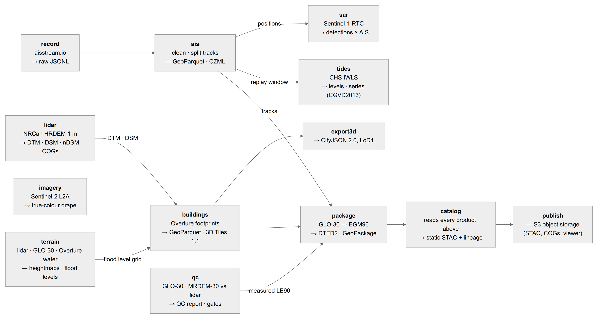
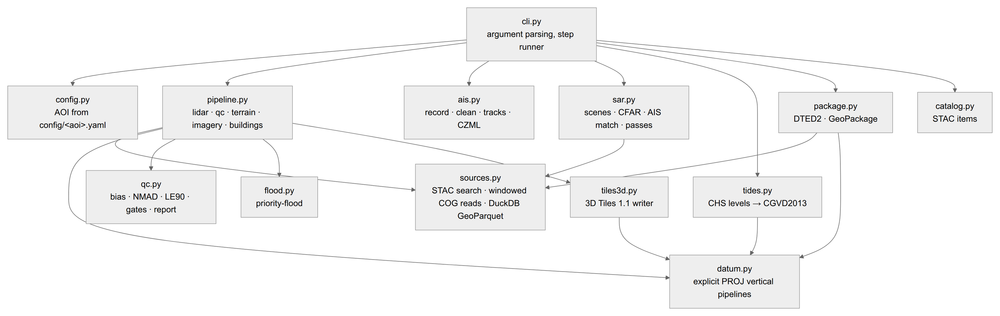
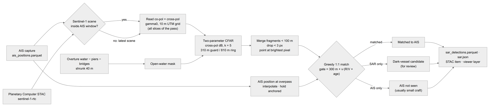
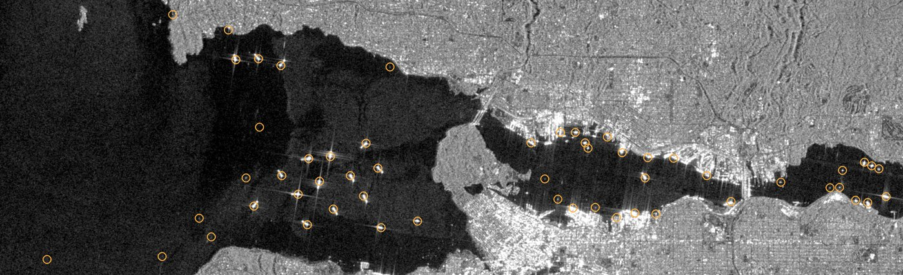
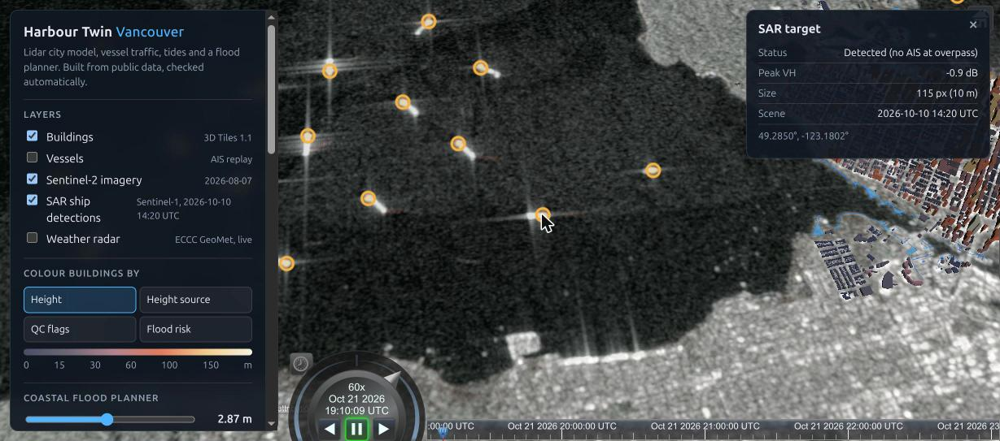
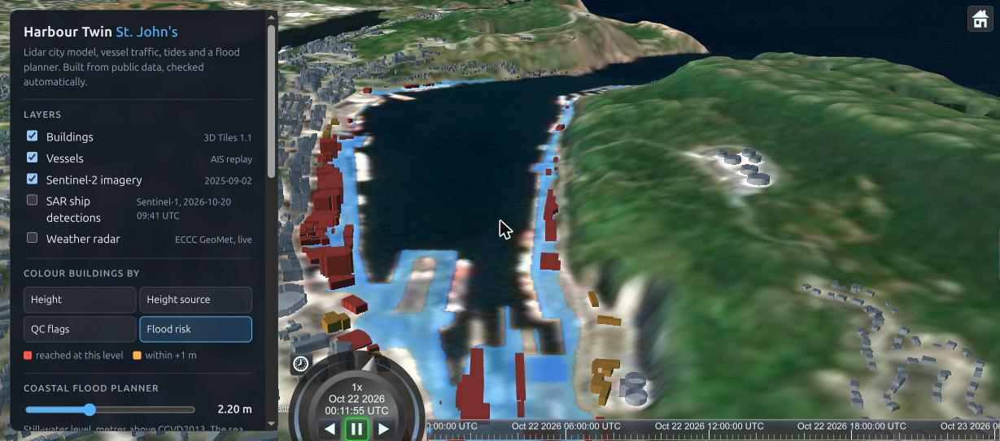

# Harbour Twin architecture

Harbour Twin is a batch pipeline (`twin`, Python) that turns public geospatial data into checked products, plus a static CesiumJS viewer that only reads those products. There is no server and no database: every step reads files from `data/<aoi>/`, writes files back, and can be re-run on its own.

This document covers how the pieces fit together, what each step reads and writes, the height and datum contract every product follows, the SAR × AIS cross-check, and how to extend the system. Upstream sources and their licences are listed in [DATA.md](DATA.md).

## 1. Pipeline



Each box is a step of `twin <aoi> <step...>`. Arrows show the real file dependencies between steps; steps without an incoming arrow read only upstream data. `make data` runs them all in order:

```
lidar qc terrain imagery buildings ais sar tides package catalog
```

| Step | Code | Reads | Writes |
|---|---|---|---|
| `lidar` | `pipeline.lidar` | NRCan HRDEM 1 m DTM + DSM (COG, windowed) | `data/<aoi>/dtm_cgvd2013.tif`, `dsm_cgvd2013.tif`, `ndsm.tif` (2 m, UTM, CGVD2013) |
| `qc` | `pipeline.elevation_qc`, `qc.py` | HRDEM, MRDEM-30, Copernicus GLO-30 at 30 m | `qc_report.json`, `QC_REPORT.md`, `glo30_egm2008_qcgrid.tif` |
| `terrain` | `pipeline.terrain`, `flood.py` | HRDEM DTM, GLO-30, Overture water + piers | `web/data/<aoi>/terrain_{core,context}.bin`, `terrain.json`, `ground_cgvd2013_core.bin`, `flood_level_core.bin` |
| `imagery` | `pipeline.imagery` | Sentinel-2 L2A `visual` COGs | `sentinel2.jpg`, `sentinel2.json` |
| `buildings` | `pipeline.buildings`, `tiles3d.py` | Overture buildings, lidar COGs, flood-level grid | `buildings.parquet`, `web/.../buildings/tileset.json` + `tiles/*.glb`, `buildings_summary.json` |
| `record` | `ais.record` | aisstream.io WebSocket | `data/cache/<aoi>/ais_raw.jsonl` (appends) |
| `ais` | `ais.build` | raw JSONL | `ais_positions.parquet`, `ais_tracks.parquet`, `web/.../ais.czml` |
| `sar` | `sar.build` | Sentinel-1 RTC COGs, Overture water, AIS positions | `sar_detections.parquet`, `web/.../sar.json`, `sar.jpg` |
| `tides` | `tides.build` | CHS IWLS station metadata + water levels | `web/.../tide.json` |
| `package` | `package.run` | GLO-30, QC report, buildings, AIS tracks | `offline/dted/*.dt2`, `offline/<aoi>_offline.gpkg`, `offline/manifest.json` |
| `catalog` | `catalog.build` | every product above, `lineage.json` | `data/<aoi>/stac/` (static STAC catalog) |
| `passes` | `sar.next_passes` | Sentinel-1 STAC history | prints the next overpasses (no files) |

`lineage.json` is updated by several steps (upstream item ids, building summary, SAR scene) and is the source of the STAC `processing:lineage` and `source_items` fields.

## 2. Modules



| Module | Responsibility |
|---|---|
| `cli.py` | Parses `twin <aoi> <steps>` and runs steps in order. The only place that knows the step list. |
| `config.py` | Loads `config/<aoi>.yaml` into an `AOI`: bounding boxes, resolutions, accuracy specs, CHS station, sea check points. Picks the UTM zone. Owns the `data/`, `web/data/` and cache paths. |
| `sources.py` | All upstream reads. STAC search (NRCan, Earth Search, Overture), windowed COG reads into a common `Grid` with explicit overview selection, and bbox-filtered GeoParquet through DuckDB. Nothing downloads whole files. |
| `datum.py` | Vertical datums. Explicit PROJ pipelines between EGM2008, EGM96, CGVD2013 and WGS 84, with the NAD83(CSRS) → WGS 84 Helmert step that PROJ's default skips. `shift_grid` builds a correction raster for any grid. |
| `qc.py` | Accuracy metrics (bias, RMSE, NMAD, LE90/95 by slope), spec gates and the Markdown/JSON report. |
| `pipeline.py` | The elevation and city-model steps, composed from the modules above. |
| `flood.py` | Priority-flood: the lowest still-water level at which the sea reaches each cell. |
| `tiles3d.py` | Writes OGC 3D Tiles 1.1: one glTF per tile, with `EXT_mesh_features` + `EXT_structural_metadata` so every building is pickable and styleable. |
| `ais.py` | AIS capture (resilient WebSocket recorder), cleaning (impossible jumps, null island, duplicates), gap-based track splitting and CZML. |
| `sar.py` | Sentinel-1 scene search, CFAR ship detection, AIS interpolation and matching, overpass prediction. |
| `tides.py` | CHS station levels and observed series, converted from chart datum to CGVD2013. |
| `package.py` | DTED Level 2 cells (MIL-PRF-89020B grid and header) and the offline GeoPackage. |
| `catalog.py` | Static STAC catalog with projection, checksums, lineage and the QC verdict. |

The dependency rule: step modules depend on `sources`, `datum` and `qc`, never on each other's internals. Steps talk to each other only through files.

## 3. Heights and datums

Every height carries its vertical datum. Conversions go through `datum.py`, never through PROJ's automatic choice, because PROJ's default CGVD2013 → WGS 84 transform is off by 0.3 m in Vancouver and 1.05 m in St. John's (tested in `test_datum.py`).

| Product | Horizontal | Vertical | Units |
|---|---|---|---|
| Lidar DTM / DSM COGs | UTM NAD83(CSRS) | CGVD2013 (EPSG:6647) | m, float32 |
| QC grid | UTM | EGM2008 (EPSG:3855) | m |
| Viewer terrain grids | WGS 84 lon/lat | WGS 84 ellipsoid (EPSG:4979) | int16 decimetres |
| Planner ground + flood grids | WGS 84 lon/lat | CGVD2013 | int16 decimetres |
| Building attributes (ground, roof, flood level) | — | CGVD2013 | m |
| 3D Tiles geometry | ECEF via local ENU | WGS 84 ellipsoid | m |
| Tide levels and series | — | CGVD2013 (from chart datum) | m |
| DTED Level 2 | WGS 84, 1″ posts | EGM96 (EPSG:5773), by spec | whole m |
| GeoPackage elevation | UTM | EGM96 | m, float32 |

Tide stations publish their chart-datum offset either to CGVD2013 directly (Vancouver, 07735) or only to the NAD83(CSRS) ellipsoid (St. John's, 00905). In the second case `tides.chart_datum_in_cgvd2013` goes through the CGG2013a geoid and records which route it took in `tide.json` (`offset_from`).

## 4. SAR × AIS cross-check



Ships are bright point targets on dark sea in C-band radar. `sar.build`:

1. **Picks a scene.** It uses the latest Sentinel-1 RTC scene inside the AIS capture window if there is one, otherwise the latest scene of the past 30 days, or `--scene <id>`. All slices of the same overpass are mosaicked, because an AOI can straddle two.
2. **Reads backscatter.** Co-pol (VV or HH) and cross-pol (VH or HV) gamma0 are read on a 10 m UTM grid. Sentinel-1 records HH/HV where ice is monitored (Newfoundland) and VV/VH elsewhere, and both pairs work.
3. **Masks to open water.** It takes Overture/OSM water, removes piers, breakwaters and bridges (bridges by 150 m, because SAR images them as several offset lines), then shrinks the result 40 m off the shore.
4. **Runs CFAR.** It uses two-parameter CFAR on cross-pol dB: a pixel is a target when it exceeds the clutter mean by 5 standard deviations, measured only over water cells in the ring between a 310 m guard box and an 810 m background box. Box sums use integral images (`box_sum`), so a 3,600 × 1,800 scene takes about a second.
5. **Turns blobs into targets.** Fragments within 100 m (the sidelobe cross of one ship) are merged, blobs under 3 pixels are dropped, and each target is placed at its brightest pixel.
6. **Matches to AIS.** Each vessel's position at the overpass is interpolated between fixes. An anchored vessel (SOG ≤ 0.5 kn) holds its last fix for up to 3 h. Detections and AIS positions on the analysed water are then matched greedily, nearest first and one to one. The gate is `300 m + speed × (R/V + fix age)`, because a moving ship appears displaced along azimuth by up to R/V ≈ 115 s times its speed.

Each detection ends up with one of three statuses:

| Status | Meaning |
|---|---|
| `ais` | Matched to a vessel's AIS position |
| `dark` | SAR sees a ship, AIS reports nothing nearby: a candidate for an analyst, not a finding. Small craft without AIS, receiver gaps and SAR artefacts cause these too. |
| `no-ais` | The AIS capture does not cover the overpass, so no cross-check was possible |

AIS vessels on open water that SAR did not see are listed in `sar.json` (`ais_unseen`); they are usually small or wooden craft below the detection limit.

**Detection QC.** The picture below shows all 77 targets from the 10 Oct 2026 14:20 UTC scene over English Bay and Burrard Inlet, ringed on the radar image. Every anchored freighter in English Bay (the bright crosses) is detected. A false alarm on the Lions Gate Bridge led to the bridge mask.



In the viewer, targets are coloured by status over the radar image:



**Getting a cross-checked result.** Sentinel-1 passes Vancouver at about 02:02 UTC (ascending) and 14:21 UTC (descending), each repeating every 12 days. `make passes` prints the next ones. To cross-check, record AIS across a pass, then rebuild:

```bash
make passes                         # e.g. 2026-10-22T14:20:55Z sentinel-1d descending
mv data/cache/vancouver/ais_raw.jsonl data/cache/vancouver/ais_raw_2026-10-21.jsonl   # keep the old capture
make record MIN=120                 # start ~1 h before the pass
make ais                            # ais → sar → tides → package → catalog
```

The scene usually appears in the Planetary Computer catalogue within one to a few days of the pass; re-run `make ais` once it does.

**Known limits.** The azimuth shift is handled by widening the gate, not by moving the AIS position, because the sign convention has not yet been validated against a coincident capture. The CFAR threshold was chosen by eye on one scene. A labelled set (AIS-matched targets as positives) would allow a proper ROC curve.

## 5. Quality gates and tests

`make test` runs 52 tests. `make validate` runs the Khronos glTF validator on every tile.

| File | What it pins |
|---|---|
| `test_datum.py` | Geoid values against EPSG reference numbers, the CSRS Helmert step, PROJ's ballpark error, round trips, the chart-datum route through CGG2013a |
| `test_qc_flood.py` | Metric definitions (NMAD, LE90), spec gates, priority-flood behaviour behind barriers |
| `test_tiles3d.py` | Our own glb parsed back: structure, metadata and roofs landing at the right ellipsoidal height |
| `test_ais_package.py` | AIS cleaning and track splitting, DTED grid geometry and file naming |
| `test_sar.py` | Integral-image box sums, CFAR on synthetic clutter (ships found, no false alarms, shore ignored), AIS interpolation, matching gates, one-to-one assignment |
| `test_products.py` | Acceptance tests on the published products of `$(AOI)`: datum-error demo fails the gates, sea surfaces sit at 0 m, tiles and STAC resolve, DTED headers parse |

`make test AOI=stjohns` runs the acceptance tests against the St. John's products.

## 6. Viewer

`web/` is a static site; `make serve` serves it locally and any static host works. `web/app.js` reads only `web/data/<aoi>/` (`?aoi=stjohns` switches cities):

| File | Used for | If missing |
|---|---|---|
| `terrain.json` + `terrain_*.bin` | `CustomHeightmapTerrainProvider` (no Cesium ion token) | required |
| `buildings/tileset.json` | 3D Tiles, styled by height, source, QC flag or flood level | required |
| `buildings_summary.json`, `flood_level_core.bin`, `ground_cgvd2013_core.bin` | Flood planner counts and overlay | required |
| `sentinel2.jpg/json` | Imagery drape | required |
| `ais.czml` | Vessel replay and clock | "No AIS capture" note |
| `tide.json` | Flood presets, follow-tide mode, starting level | planner works without presets |
| `sar.json`, `sar.jpg` | SAR targets and radar image | layer disabled |
| `qc_report.json` | Data-quality panel, city name | panel shows building stats only |

The St. John's twin, with the planner at record + 1 m (2.20 m CGVD2013, 86 of 7,308 buildings reached):



## 7. Extending

- **A new city:** copy `config/stjohns.yaml` and set the bounding boxes, CHS station code, sea check points and specs. Then run `make data AOI=<slug>`, `make test AOI=<slug>` and `make validate AOI=<slug>`, and add an opening camera view to `VIEWS` in `web/app.js` (otherwise the camera looks north from the core area's southern edge). Lidar coverage depends on NRCan HRDEM; check `lidar` reports most of the core as valid.
- **A new upstream source:** add a reader to `sources.py` that returns an array on a `Grid` (rasters) or a GeoDataFrame (vectors), and record the upstream item ids with `_save_lineage`. If it carries heights, tag its vertical datum and convert through `datum.py`.
- **A new product:** add a step function, register it in `cli.STEPS` and the `run` table, write outputs under `data/<aoi>/` or `web/data/<aoi>/`, add a STAC item in `catalog.py`, and add an acceptance test to `test_products.py`.

## 8. Diagram sources

The diagrams are generated from Mermaid sources in [`diagrams/`](diagrams/). After editing one, run `.venv/bin/python tools/render_diagrams.py` (it needs Google Chrome or Chromium) to regenerate the PNGs in `img/`. The viewer screenshots were taken from `make serve` in Chrome.
